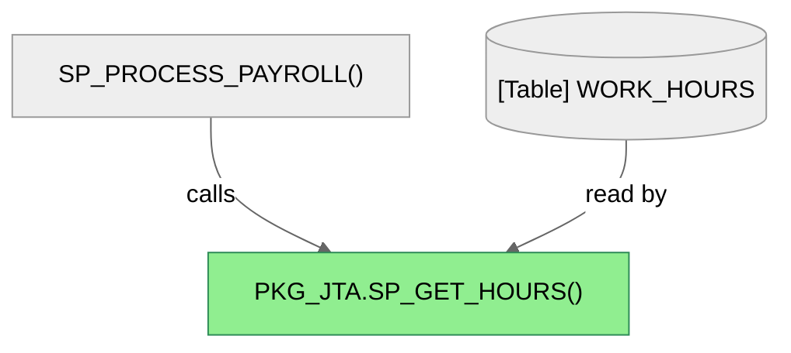
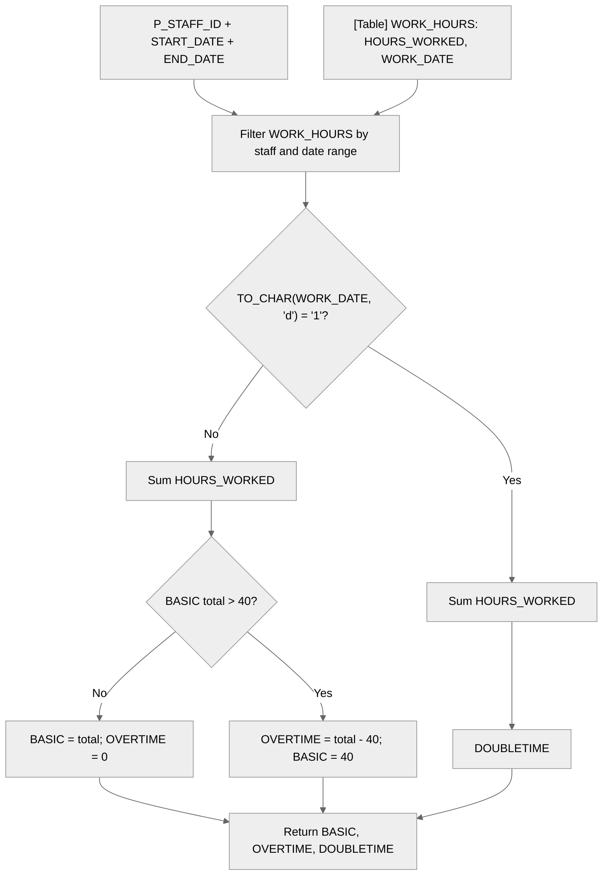

# How `sp_get_hours` calculates worked hours

> This file is a style and structure reference for future PL/SQL lineage reports. Its findings are specific to `PKG_JTA.SP_GET_HOURS`.

## In brief

`PKG_JTA.SP_GET_HOURS` reads matching rows from `WORK_HOURS` for one staff member and date range. It puts the sum for rows whose day code is `'1'` into `DOUBLETIME`, and the sum for all other matching rows into `BASIC`. If `BASIC` exceeds 40, the excess goes to `OVERTIME` and `BASIC` is capped at 40.

*High-level dependencies observed in source; they are not generated by an indexed relationship query.*

Column Level Dependency

The following flow expands the table dependency into the source columns, filters, and output parameters.

1. Set `BASIC`, `OVERTIME`, and `DOUBLETIME` to zero (lines 28–30).
2. Sum `HOURS_WORKED` from `WORK_HOURS` for the staff member and date range where `TO_CHAR(WORK_DATE, 'd') = '1'`; store the result in `DOUBLETIME` (lines 32–36).
3. Sum `HOURS_WORKED` for the same staff member and date range where that day code is not `'1'`; store the result in `BASIC` (lines 38–42).
4. If `BASIC` is greater than 40, set `OVERTIME` to the excess and reduce `BASIC` to 40 (lines 44–46). Otherwise, `OVERTIME` remains zero.

The date filter uses `BETWEEN`, so both boundary values are included in the comparison; the procedure does not add an end-of-day adjustment. `NVL(SUM(...), 0)` makes an empty sum return zero.

> **Important:** The code does not define what day code `'1'` means, and `DOUBLETIME` is just the name of an output variable here. The source alone does not establish a weekday or pay-rate interpretation.

## Inputs and outputs

| Parameter | Direction | What it represents |
|---|---|---|
| `P_STAFF_ID` | Input | Staff member to include |
| `START_DATE` | Input | Beginning of the date range |
| `END_DATE` | Input | End of the date range |
| `BASIC` | Output | Hours from matching rows with day code other than `'1'`, capped at 40 |
| `OVERTIME` | Output | Portion of that non-`'1'` total above 40 |
| `DOUBLETIME` | Output | Hours from matching rows with day code `'1'` |

## Caller observed in the source

`SP_PROCESS_PAYROLL` calls this procedure at [line 115](../../../src/datalineague/pkg.sql#L115), passing the staff ID, date range, and three output variables. This is a call visible in the source, not a relationship produced by a call-graph index.

## Evidence and scope

The procedure body is in [`pkg.sql`](../../../src/datalineague/pkg.sql#L17), and its registration and six parameters are listed in the [Phase 1 registry](../../../02Development_Zone/sp_get_hours.registry.json). The calculations above are a **manual reading of the procedure source**: this project version does not yet produce indexed call, SQL, or variable-flow relationships. In particular, `WORK_HOURS` and its columns are unqualified names, so their schema-level identity has not been verified.

The day-code comparison uses Oracle's `TO_CHAR(date, 'd')`; the code itself does not document its NLS-dependent day numbering. No calendar-day label is inferred here.
