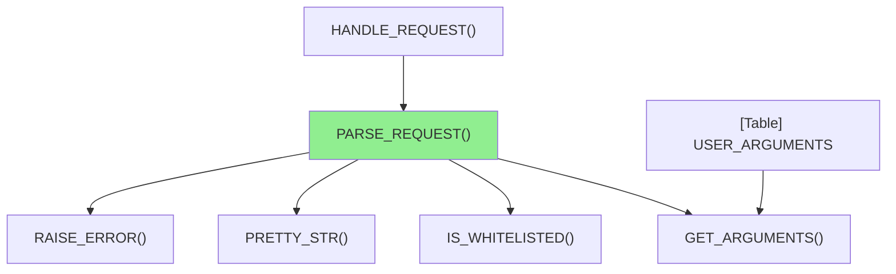
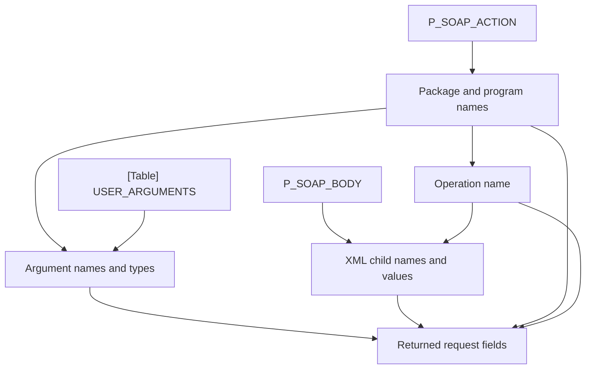

# How `parse_request` prepares a SOAP request

`SOAP_SERVER_PKG.PARSE_REQUEST` validates a SOAP action, checks the selected package against a whitelist, and combines argument metadata with values from the SOAP XML body into a `t_request` record. Its known caller in the supplied package body is `HANDLE_REQUEST`.

## In brief

This is the generated index-backed brief. `USER_ARGUMENTS` is an Oracle data dictionary view, despite the index's generic `[Table]` label. `GET_ARGUMENTS` reads it indirectly for the target; the target itself contains no indexed table read or write. The view name is unqualified, not schema-resolved. See [the metadata query](../testcases/plsql/soap_server_pkg.pkb#L219) and [the call](../testcases/plsql/soap_server_pkg.pkb#L521).

Column Level Dependency

The following is a **manual source trace**, not indexed assignment or column-derivation lineage:

- The action's last two slash-separated components become `package_name` and `program_name`, validated with `DBMS_ASSERT`; `pretty_str` applies `INITCAP` and removes underscores to form `operation_name` ([action handling](../testcases/plsql/soap_server_pkg.pkb#L501), [helper](../testcases/plsql/soap_server_pkg.pkb#L149)).
- `USER_ARGUMENTS.ARGUMENT_NAME`, `POSITION`, and `DATA_TYPE` are selected for the uppercased package and program names, non-null argument names and `IN` mode; rows are ordered by `OVERLOAD` and `SEQUENCE` and fetched into an argument collection ([query and fetch](../testcases/plsql/soap_server_pkg.pkb#L217)). `ARGUMENT_NAME` is compared case-insensitively with each XML child name, after stripping its namespace prefix; the matched name is lowercased and its `DATA_TYPE` copied to the result ([matching](../testcases/plsql/soap_server_pkg.pkb#L538)).
- The first child node's value is converted with `TO_DATE` and `g_xml_date_format` for `DATE`, with `TO_NUMBER` for `NUMBER`, and otherwise stored as a string ([value handling](../testcases/plsql/soap_server_pkg.pkb#L570)). The collection and record layout are inferred from assignments in this body; the package specification was not supplied.

## Inputs and output

| Item | Direction | Role |
|---|---|---|
| `p_soap_action` | Input | Supplies the package and program components. |
| `p_soap_body` | Input | Supplies the XML request body. |
| `t_request` | Return | Contains the package, program, operation and parsed parameters. |

## Main path

1. Reject a null action or body via `RAISE_ERROR` ([source](../testcases/plsql/soap_server_pkg.pkb#L493)).
2. Normalize and validate the action's names, derive the operation name, and reject a non-whitelisted request ([source](../testcases/plsql/soap_server_pkg.pkb#L501)). The supplied whitelist implementation checks the package against `employee_service`; it does not inspect its program-name parameter ([source](../testcases/plsql/soap_server_pkg.pkb#L87)).
3. Obtain input argument metadata, parse the XML and match each operation child to an argument; reject unmatched names, then return the typed request ([source](../testcases/plsql/soap_server_pkg.pkb#L521)).

The indexed `CALLS` relationships to `RAISE_ERROR`, `PRETTY_STR`, `IS_WHITELISTED`, and `GET_ARGUMENTS`, and the caller relationship from `HANDLE_REQUEST`, are `resolved` with no reason supplied. The `GET_ARGUMENTS` read of `USER_ARGUMENTS` is likewise indexed as `resolved`, meaning identity under the index rules rather than confirmed database schema binding. `HANDLE_REQUEST` passes CGI-derived action and body values and subsequently invokes `EXECUTE_REQUEST`; that later execution is outside this target's own lineage ([caller](../testcases/plsql/soap_server_pkg.pkb#L757)).

## Scope and technical note

Analysis covers only [the supplied package body](../testcases/plsql/soap_server_pkg.pkb#L1), so callers or dependencies in other files are not established. The registry was freshly generated and the target spans lines 458–589. Call and SQL extraction plus the query CLI ran successfully; the transitive write query returned no indexed writes. The index has no `ASSIGNS_TO` implementation, so variable and parameter flows above are manual. Sixteen transitive call records are `unsupported` with reason `EXTERNAL_BUILTIN_PACKAGE` for Oracle/APEX package routines whose source is unavailable here; they are not resolved and are omitted from the diagram. The scanner and relationship extractor produced no diagnostics. No local Mermaid renderer was available; both diagrams were manually checked for fences, identifiers, and references.

[Generated registry and relationship index](./parse_request.registry.json).

### Workflow log

| Step | Command or action | Output or result |
|---|---|---|
| 1 | Classify request | Lineage report, not implementation. |
| 2 | Resolve selected `parse_request` | `testcases/plsql/soap_server_pkg.pkb`. |
| 3 | `plsql-lineage-scanner-macos-arm64 testcases/plsql/soap_server_pkg.pkb -o 02Development_Zone/parse_request.registry.json` | Fresh registry: 72 entities, target lines 458–589, two input parameters, no scanner diagnostics. |
| 4 | `.venv/bin/datalineague relate testcases/plsql/soap_server_pkg.pkb --registry 02Development_Zone/parse_request.registry.json`; `query` the registry for `calls`, `callers`, `reads`, `writes`, `unresolved` with `--transitive`, and `brief`, all for `SOAP_SERVER_PKG.PARSE_REQUEST` | Index: 135 relationships, 27 external entities, no relationship diagnostics. Calls, SQL reads and query CLI executed; `ASSIGNS_TO` entry point not implemented. Outputs inspected; 16 unsupported external-package calls. |
| 5 | Establish implementation contracts | Not applicable: report request. |
| 6 | Delegate an implementation phase | Not applicable: report request. |
| 7 | Manage concurrent contract changes | Not applicable: no implementation or delegation. |
| 8 | Review delegated implementation | Not applicable: no delegated implementation. |
| 9 | Integrate and test implementation | Not applicable: no implementation changes. |
| 10 | Save and verify report and index | `02Development_Zone/parse_request.lineage.md` and `02Development_Zone/parse_request.registry.json`. |
| 11 | Final independent process audit | Requested as final workflow step; audit outcome is reported in the accompanying response. |
