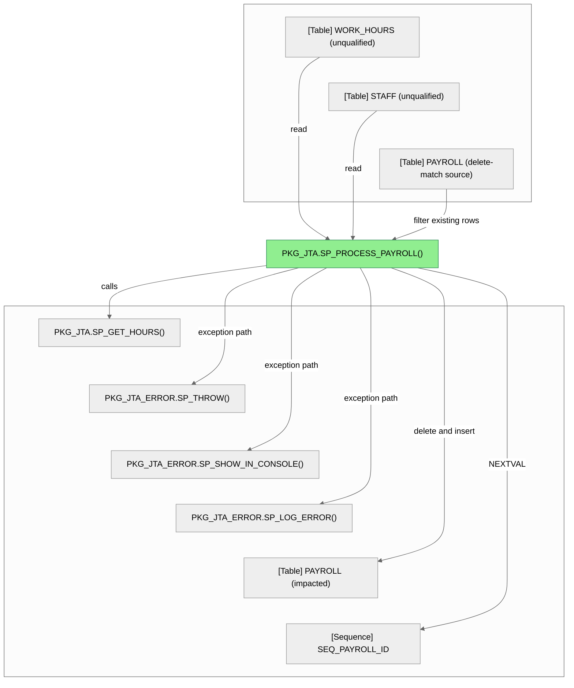
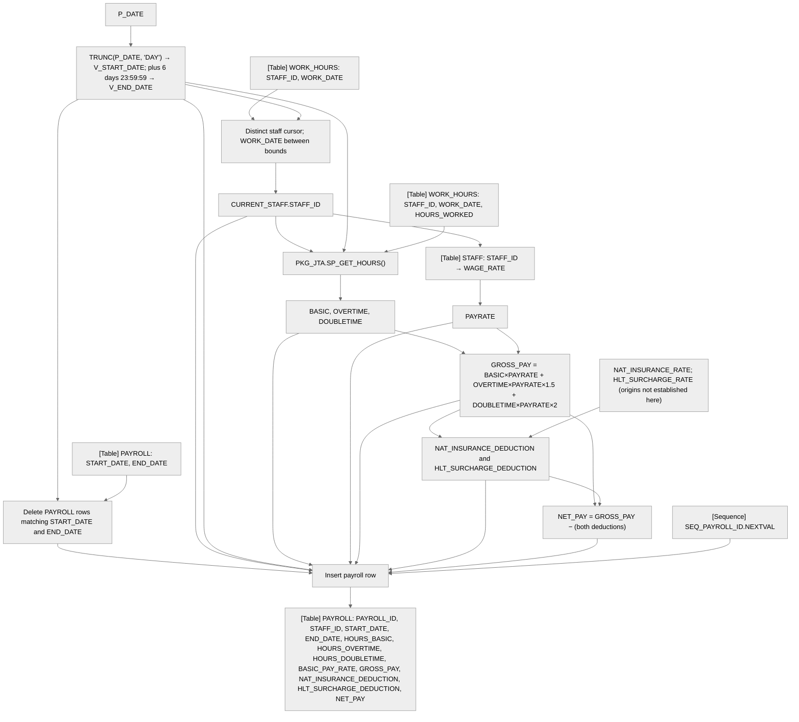

# How `PKG_JTA.SP_PROCESS_PAYROLL` builds weekly payroll

`SP_PROCESS_PAYROLL` derives a date window from one input date, finds staff with work-hour records in that window, calculates pay and deductions, then replaces matching payroll rows with the results. The source shows a direct call to `SP_GET_HOURS`; the table, call, and column relationships below are manual source observations, not indexed lineage.

## In brief

*The chart includes dependencies manually observed in the supplied source. No indexed call or SQL relationship query is implemented in this project version. No caller of `SP_PROCESS_PAYROLL` was found in this source file.*

## Inputs and outputs

| Parameter | Direction | Role |
|---|---|---|
| `P_DATE` | Input (`DATE`) | Date used to derive `V_START_DATE` and `V_END_DATE` |
| Payroll rows | Database side effect | Existing rows matching the derived dates are deleted; one new row per cursor staff member is inserted |
| Transaction state | Database side effect | Commits when at least one row was inserted; exception paths roll back |

## Main data path

1. At [lines 72–82](../src/datalineague/pkg.sql#L72), `P_DATE` initializes `V_START_DATE` with `TRUNC(P_DATE, 'DAY')`; `V_END_DATE` is set six days plus 23:59:59 later. The comment describes a Sunday-to-Saturday week, but the effective first day depends on Oracle date settings not established by this source.
2. At [lines 85–88](../src/datalineague/pkg.sql#L85), cursor `C_STAFF_WORKED` selects distinct `STAFF_ID` values from unqualified `WORK_HOURS`, filtered by `WORK_DATE` between the two bounds and ordered by staff ID.
3. At [lines 112–117](../src/datalineague/pkg.sql#L112), each cursor row is passed with the date bounds to `SP_GET_HOURS`; then `WAGE_RATE` is selected from unqualified `STAFF` for that staff ID.
4. At [lines 119–123](../src/datalineague/pkg.sql#L119), gross pay is calculated as basic pay plus overtime at 1.5 times the rate plus double-time at 2 times the rate. The two deduction variables are calculated using `NAT_INSURANCE_RATE` and `HLT_SURCHARGE_RATE`; their origins are not shown in this routine.
5. At [lines 126–141](../src/datalineague/pkg.sql#L126), the procedure inserts the staff ID, date bounds, hours, rates, gross pay, deductions, and net pay into unqualified `PAYROLL`; `SEQ_PAYROLL_ID.NEXTVAL` supplies the inserted payroll ID. At [lines 143–159](../src/datalineague/pkg.sql#L143), it commits if rows were processed; otherwise it raises an error, while handled exception paths roll back.

Column Level Dependency

The following is a source-level expansion of the calculation; it is not generated from indexed column edges.

`SP_GET_HOURS` reads `HOURS_WORKED`, `WORK_DATE`, and `STAFF_ID` from unqualified `WORK_HOURS` and returns the three hour values (source at [lines 17–46](../src/datalineague/pkg.sql#L17)). Its internal transformation separates rows by `TO_CHAR(WORK_DATE, 'd') = '1'` and caps `BASIC` at 40; the source does not establish what day that code means under the runtime NLS settings. `BETWEEN` includes both boundary values.

The delete filter and insert columns are shown separately because `PAYROLL` is both read to select rows for deletion and written by deletion/insertion. The insert mapping follows [lines 126–140](../src/datalineague/pkg.sql#L126). Table and sequence names are unqualified in the source; no schema resolution is implied.

## Evidence and limits

The target declaration is registered as `PKG_JTA.SP_PROCESS_PAYROLL`, parent `PKG_JTA`, in `src/datalineague/pkg.sql` at lines 72–160. It has one registered parameter, `P_DATE IN DATE`, at lines 72–74. The in-file call to `SP_GET_HOURS` is at line 115; exception-handler calls are at lines 153–158. No call site for the target itself was found in this file.

**Technical provenance:** Command: `uv run datalineague src/datalineague/pkg.sql -o 02Development_Zone/sp_process_payroll.registry.json`; output: [`sp_process_payroll.registry.json`](sp_process_payroll.registry.json). The registry was generated for this exact source, not verified as pre-existing. It contains 169 entities (1 package, 16 procedures, 7 functions, 68 parameters, 68 variables, 7 cursors, 2 types) and 0 diagnostics. The available CLI is the Phase 1 object-registry scanner only. No CALLS, SQL/table/column lineage, variable-flow extractor, relationship query, or generated report interface was available or run, so relationships and transformations in this report are manual source readings; database object identity and schema resolution remain unverified.
