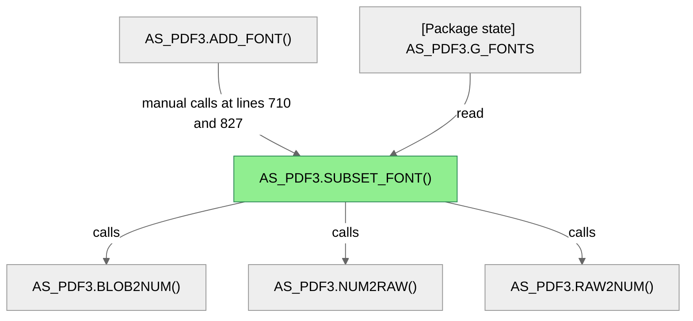
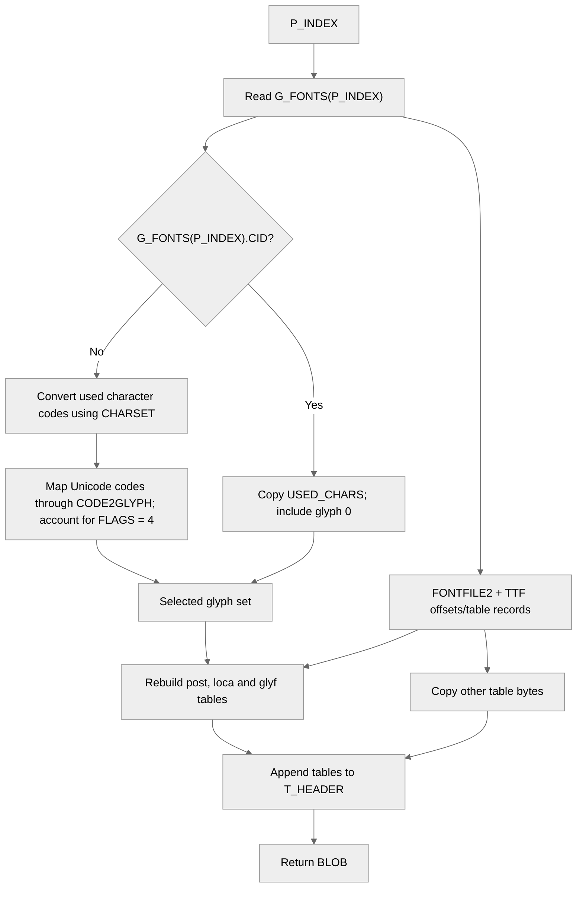

# How `AS_PDF3.SUBSET_FONT` builds a subset font BLOB

`subset_font` reads font data held in the package's `g_fonts` state, selects glyphs in use, rebuilds selected TrueType font tables, and returns the result as a BLOB. This is a source-based analysis: the repository currently provides object registration but no relationship extractor or lineage query interface.

## In brief

*Caller and helper edges above are manual source observations, not generated relationship-index edges. No SQL tables are read or written by the target.*

Column Level Dependency

The target takes a font index and returns the assembled font bytes; the internal path is as follows.

1. `p_index` selects one `g_fonts` entry. If its `cid` flag is true, the routine copies `used_chars`; otherwise it converts used character codes from the entry's `charset` and maps them through `code2glyph`, with a separate mapping expression when `flags = 4`. Glyph zero is included in either path ([`as_pdf3.pkb:472–496`](../testcases/plsql/as_pdf3.pkb#L472)).
2. The routine reads the original `fontfile2` BLOB and its TrueType table metadata. It builds a new header and table area ([`as_pdf3.pkb:498–507`](../testcases/plsql/as_pdf3.pkb#L498)).
3. The `post` table is emitted with a version-3 header; `loca` offsets and `glyf` data are rebuilt using the selected glyph set. Other table records and bytes are copied from `fontfile2` ([`as_pdf3.pkb:509–526`](../testcases/plsql/as_pdf3.pkb#L509), [`as_pdf3.pkb:527–603`](../testcases/plsql/as_pdf3.pkb#L527), [`as_pdf3.pkb:604–617`](../testcases/plsql/as_pdf3.pkb#L604)).
4. The table data is appended to the header, temporary LOB storage is freed, and `t_header` is returned ([`as_pdf3.pkb:620–623`](../testcases/plsql/as_pdf3.pkb#L620)).

The table format names and transformations are taken directly from the code. The source does not establish additional business meaning for the font flags or the stored font metadata.

## Inputs and outputs

| Parameter/value | Direction | Meaning established by the source |
|---|---|---|
| `p_index PLS_INTEGER` | Input | Index into package state `g_fonts` |
| Function result `BLOB` | Output | Rebuilt font header and table bytes |

## Caller and callees

`AS_PDF3.ADD_FONT` calls `subset_font(p_index)` at lines 710 and 827 ([`as_pdf3.pkb:710`](../testcases/plsql/as_pdf3.pkb#L710), [`as_pdf3.pkb:827`](../testcases/plsql/as_pdf3.pkb#L827)). These are the only occurrences of `subset_font` beyond its declaration in the supplied source. The direct helper calls visible in the target include `blob2num`, `num2raw`, and `raw2num` ([`as_pdf3.pkb:502–505`](../testcases/plsql/as_pdf3.pkb#L502), [`as_pdf3.pkb:515–517`](../testcases/plsql/as_pdf3.pkb#L515), [`as_pdf3.pkb:523–524`](../testcases/plsql/as_pdf3.pkb#L523)). The registry has Phase 1 entities for those helper declarations, but no indexed call edges were generated.

## Evidence and scope

The target is registered as `AS_PDF3.SUBSET_FONT` in [`subset_font.registry.json`](../.github/agents/plsql-lineage-orchestrator/subset_font.registry.json), with its full function range from lines 453 through 623, parameter `p_index`, and parent `AS_PDF3`. The body and all dependencies described above were manually read from [`as_pdf3.pkb`](../testcases/plsql/as_pdf3.pkb).

The scanner reports `UNTERMINATED_ROUTINE` for the caller `add_font` and truncates its registry range to lines 625–627. Manual source inspection verifies that the caller continues through its unnamed `end;` at line 835; both call sites therefore belong to `AS_PDF3.ADD_FONT`. This affects caller-edge registration only, not the target's complete registration. Other scanner diagnostics are outside this target and caller chain.

No SQL statements or persistent table dependencies appear in `subset_font`; its visible input resource is package state. Built-in PL/SQL and Oracle utility-package operations are omitted from the high-level dependency chart.

## Technical provenance

**Relationship status:** manually observed from the supplied source; no indexed `CALLS`, SQL read/write, `DERIVES_FROM`, or `ASSIGNS_TO` edges are available. The only runnable lineage interface found is the Phase 1 entity/diagnostic scanner. The generated registry has 410 entities and 12 diagnostics.

| Phase | Result |
|---|---|
| 2 — Calls | Not executed: no runnable call-graph extractor emitting `CALLS` edges. |
| 3 — SQL lineage | Not executed: no runnable SQL read/write or `DERIVES_FROM` extractor. |
| 4 — Data flow | Not executed: no runnable assignment extractor emitting `ASSIGNS_TO` edges. |
| 5 — Query/report | Not executed: no relationship-index query or report CLI. |

| Step | Command/action | Output path or result |
|---:|---|---|
| 1 | Classify request | Lineage report for `subset_font` |
| 2 | Resolve selected target and source | `subset_font`; `testcases/plsql/as_pdf3.pkb`, selected line 453 |
| 3 | `.github/agents/plsql-lineage-orchestrator/plsql-lineage-scanner-macos-arm64 testcases/plsql/as_pdf3.pkb -o .github/agents/plsql-lineage-orchestrator/subset_font.registry.json` | Generated this run: [`subset_font.registry.json`](../.github/agents/plsql-lineage-orchestrator/subset_font.registry.json); 410 entities, 12 diagnostics; `AS_PDF3.SUBSET_FONT`, parent `AS_PDF3`, parameter `p_index`, source `testcases/plsql/as_pdf3.pkb`, lines 453–623 |
| 4 | Inspect package scripts and source for runnable relationship entrypoints; run the scanner `--help`; inspect the registered target, references, caller, and registry output | Phases 2–5 not executed: only the Phase 1 registry CLI is present; no relation extractor or query interface; manual source observations included above |
| 5 | Contract establishment | Not applicable: this is an analysis/report request, not an implementation request |
| 6 | Phase delegation | Not applicable: no implementation phase requested |
| 7 | Contract-change coordination | Not applicable: no implementation skill was invoked |
| 8 | Review | Not applicable: no phase implementation result |
| 9 | Integration and tests | Not applicable: no implementation or runnable relationship output to integrate |
| 10 | Save and inspect report and registry | `02Development_Zone/subset_font.lineage.md`; `.github/agents/plsql-lineage-orchestrator/subset_font.registry.json` |
| 11 | Read-only `plsql-lineage-process-auditor` review of this report, registry, exact source scope, and limitations | PASS WITH GAPS: no indexed relationship extractors are available; manual observations and the `add_font` scanner diagnostic are explicitly disclosed |
