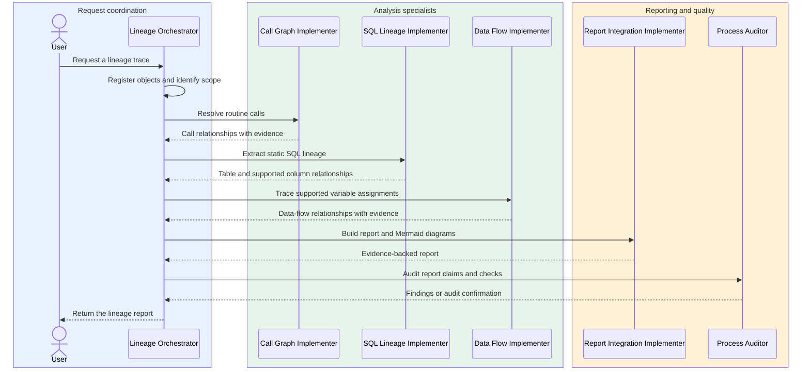
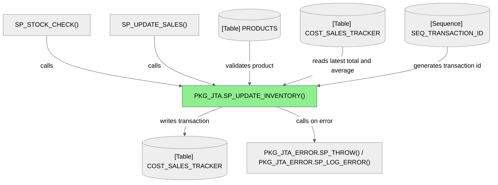

# PL/SQL Lineage Orchestrator

The **PL/SQL Lineage Orchestrator** helps trace Oracle PL/SQL packages,
procedures, functions, and data objects. It coordinates source analysis and
available lineage tools to produce concise, evidence-backed reports.

## What it does

- Traces calls, SQL reads and writes, and supported column or variable flows.
- Cites source locations and distinguishes confirmed evidence from uncertainty.
- Produces Markdown lineage reports and Mermaid diagrams when supported by the
  available project index and analysis tools.

Ask it to trace a PL/SQL object, explain where a table or column is used, or
document a routine's callers, dependencies, and data flow.

### Typical subagent sequence

The orchestrator uses the relevant specialists for each request; not every
trace needs every phase.



### Lineage agent files

```text
.github/agents/
├── plsql-lineage-orchestrator.agent.md
├── plsql-call-graph-implementer.agent.md
├── plsql-data-flow-implementer.agent.md
├── plsql-sql-lineage-implementer.agent.md
├── plsql-report-integration-implementer.agent.md
├── plsql-lineage-process-auditor.agent.md
├── plsql-lineage-validation.agent.md
└── plsql-lineage-orchestrator/
    ├── scanner.py
    └── sp_get_hours.lineage.md
```

## Standalone scanner executable

The orchestrator agent uses standalone Rust scanner executables stored in
`.github/agents/plsql-lineage-orchestrator/`. They do not require Python or
third-party packages on the deployment computer. Choose the binary matching
the deployment OS and architecture; never run a binary built for a different
platform.

```bash
. "$HOME/.cargo/env"
cargo build --locked --release --manifest-path native/Cargo.toml --bin plsql-lineage-scanner
cp native/target/release/plsql-lineage-scanner \
  .github/agents/plsql-lineage-orchestrator/plsql-lineage-scanner-macos-arm64
```

For Windows x64, build with the Windows GNU target and a MinGW-w64 linker:

```powershell
cargo build --locked --release --target x86_64-pc-windows-gnu --manifest-path native/Cargo.toml --bin plsql-lineage-scanner
Copy-Item native/target/x86_64-pc-windows-gnu/release/plsql-lineage-scanner.exe `
  .github/agents/plsql-lineage-orchestrator/plsql-lineage-scanner-windows-x64.bin
```

Run it with one or more PL/SQL files or directories and a registry output path:

```bash
.github/agents/plsql-lineage-orchestrator/plsql-lineage-scanner-macos-arm64 \
  src/datalineague/pkg.sql -o object-registry.json
```

On Windows x64, use PowerShell:

```powershell
& ".github/agents/plsql-lineage-orchestrator/plsql-lineage-scanner-windows-x64.bin" `
  "src/datalineague/pkg.sql" -o "object-registry.json"
```

The standalone executable is Rust-only. The Python project package also
provides an optional native extension built through Maturin.

## Output example

The following report demonstrates the expected structure and level of
evidence. It is also available as [sp_update_inventory.lineage.md](02Development_Zone/sp_update_inventory.lineage.md).

---

# Inventory update lineage: `PKG_JTA.SP_UPDATE_INVENTORY`

## In brief

`SP_UPDATE_INVENTORY` checks that the product exists, reads its latest recorded total and average cost, calculates the new values from the requested quantity, and inserts a transaction into `COST_SALES_TRACKER`. Calls to this routine are visible in `SP_STOCK_CHECK` and `SP_UPDATE_SALES`.



*Dependencies are manually traced from the supplied package source; they are not generated indexed relationships.*

## Inputs and effects

| Parameter | Direction | Role |
|---|---|---|
| `P_PRODUCT_ID` | Input | Product whose tracker record is updated |
| `P_QUANTITY` | Input | Quantity change; positive adds stock, negative removes stock |
| `P_NEW_COST` | Input | Unit cost required when adding stock; ignored when removing stock |

The procedure has no `OUT` parameters. Its persistent effect is an inserted row in `COST_SALES_TRACKER`; it commits on success. On an exception, it calls the error logger and rolls back.

## Callers observed in the source

| Caller | Source evidence | Values passed |
|---|---|---|
| `SP_UPDATE_SALES` | [`pkg.sql`, line 1104](src/datalineague/pkg.sql#L1104) | Product index, negative summed sold quantity, `NULL` cost |
| `SP_STOCK_CHECK` | [`pkg.sql`, line 1533](src/datalineague/pkg.sql#L1533) | Product ID, negative stock difference, `NULL` cost |

These call sites are source observations, not indexed `CALLS` edges.

<details>
<summary>Column Level Dependency</summary>

### Reads and validation

- `PRODUCTS.PRODUCT_ID` is selected using `P_PRODUCT_ID` to verify the product exists (lines 203–212).
- `COST_SALES_TRACKER.TOTAL` and `AVERAGE_COST_PER_UNIT` are read for the matching product's greatest `TRANSACTION_ID` (lines 215–245). If no tracker row exists, the corresponding old value stays at zero.
- `P_QUANTITY = 0` is rejected. A positive quantity requires `P_NEW_COST > 0` and non-null; a negative quantity is rejected if it would make the new total negative (lines 197–200, 251–256, 275–278).

### Derived values and write

- For a positive quantity, `V_NEW_TOTAL = V_OLD_TOTAL + P_QUANTITY`; `V_NEW_AVG` is the weighted average rounded to two decimal places; `V_DIRECTION` is set to `'IN'`; and `V_COST` takes `P_NEW_COST` (lines 251–265).
- For a negative quantity, `V_NEW_TOTAL = V_OLD_TOTAL + P_QUANTITY`; the average remains `V_OLD_AVG`; and `V_COST` is set to `NULL` (lines 267–282).
- The procedure inserts into `COST_SALES_TRACKER` columns `TRANSACTION_ID`, `PRODUCT_ID`, `DIRECTION`, `DATE_TIME`, `QUANTITY`, `TOTAL`, `AVERAGE_COST_PER_UNIT`, and `COST_PER_UNIT` (lines 286–294). The transaction ID comes from `SEQ_TRANSACTION_ID.NEXTVAL`; the date/time comes from `SYSDATE`.

### Called routines

- `PKG_JTA_ERROR.SP_THROW` is called for invalid quantity, unknown product, invalid add-cost, or a negative resulting total (lines 198–200, 208–210, 252–254, 276–278).
- The outer exception handler calls `PKG_JTA_ERROR.SP_LOG_ERROR` and then rolls back (lines 298–302).

</details>

## Evidence and scope

The target body is in [`pkg.sql`](src/datalineague/pkg.sql#L181), and its registration and three parameters are in the [source-specific registry](02Development_Zone/sp_update_inventory.registry.json). This report is a manual reading of the supplied source: the available project implementation registers objects but does not emit indexed call, SQL, or variable-flow relationships. Table references are unqualified in the SQL, so schema-level object identity has not been verified.
